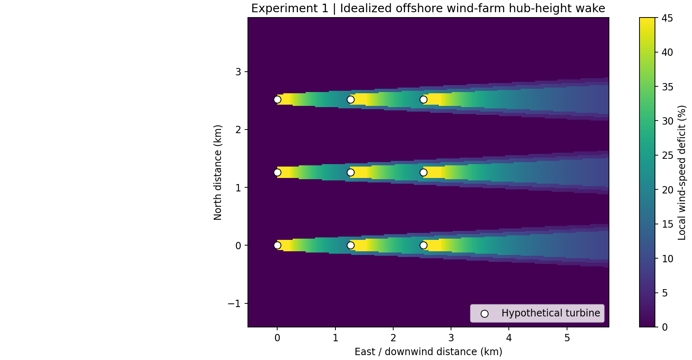
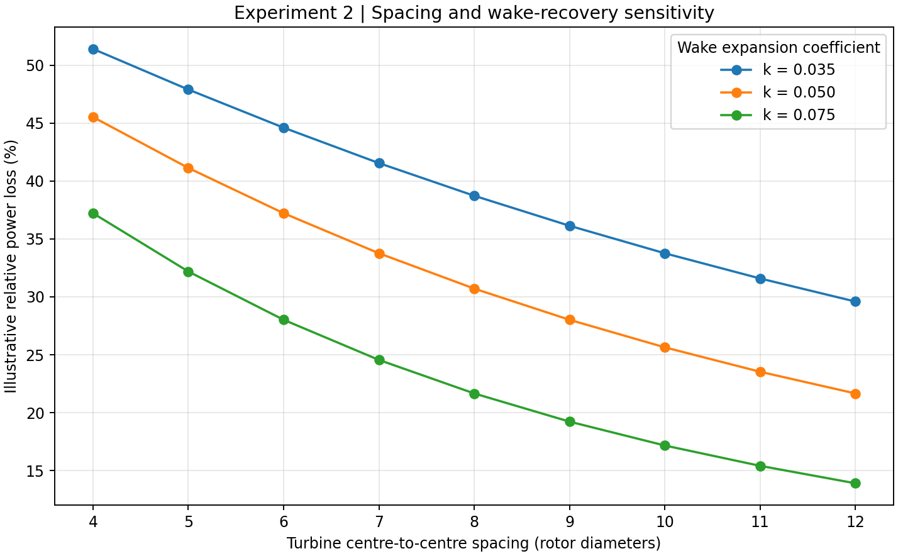
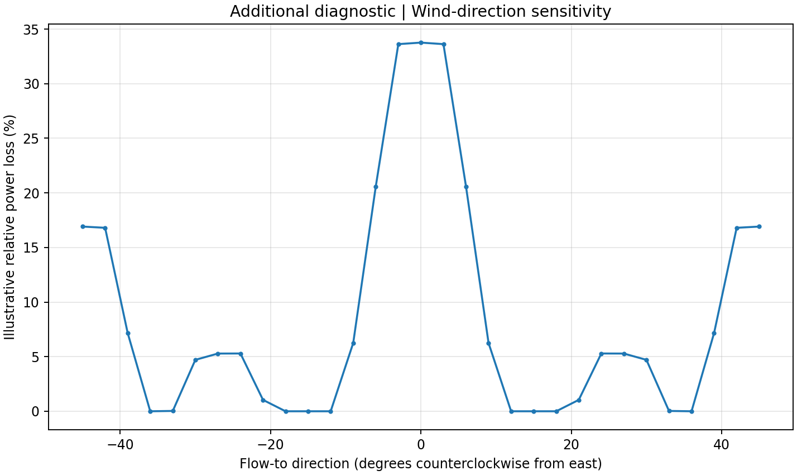

# Offshore wind-farm wakes and atmospheric feedbacks: idealized Python experiments

A **small, reproducible, idealized engineering wake-model project** motivated by research questions about offshore wind farms and the marine atmospheric boundary layer. Intended as a transparent first step toward designing **with- versus without-wind-farm high-resolution atmospheric experiments**, including possible precipitation effects. The simulations here **do not estimate precipitation or ocean feedbacks**.

This is **not** PyWake, FLORIS, WRF, or an atmospheric large-eddy simulation. It implements a basic Jensen/Park top-hat wake model in NumPy to make assumptions inspectable; it is **not benchmarked/validated against observations**. All turbines and meteorological inputs are **synthetic/hypothetical**.

## Scientific questions

1. What idealized hub-height wind-speed deficits occur downstream of a 3 × 3 offshore turbine array?
2. How do wind-farm spacing and the empirical wake-expansion coefficient alter predicted turbine-level wind speeds and illustrative energy losses?
3. How does flow direction change wake interactions? (supplemental diagnostic)

## Figures

**Experiment 1 — spatial wind-speed deficit**



**Experiment 2 — wake sensitivity to turbine spacing and wake expansion**



**Additional diagnostic — wind direction sensitivity**



## Quick start

Use Python 3.11+ and a fresh virtual environment:

```bash
python3 -m venv .venv
source .venv/bin/activate
python -m pip install -r requirements.txt
python -m experiments.run_experiments
python -m pytest -q
```

Outputs are written to `figures/*.png` and `results/spacing_sensitivity.csv`.

## Numerical method and assumptions

Jensen top-hat wake velocity deficit (inside the expanding wake):

\[
\frac{\Delta U}{U_\infty} = \frac{1-\sqrt{1-C_T}}{\left(1+2kx/D\right)^2}, \qquad R_w(x)=D/2+kx.
\]

- `D = 180 m` rotor diameter (hypothetical), constant `C_T = 0.8`, and ambient `U = 10 m/s`.
- A constant empirical wake-expansion coefficient `k` represents changes in wake recovery; the cases `0.035`, `0.05`, and `0.075` are **sensitivity choices, not a validated stability parameterization**.
- Uniform steady flow at hub height; no Coriolis effect, shear, veer, atmospheric stability model, or time evolution.
- Top-hat wakes expand linearly. For turbine inflows, partial wake coverage uses analytic circle-intersection area fractions.
- Simultaneous wake interactions are combined by **root-sum-square of fractional deficits** relative to uniform ambient wind, with speed clamped above zero. This is a simple superposition approximation, not a conserved flow solution.
- The plot of velocity deficits samples the top-hat model at grid points, whereas turbine power uses **rotor-overlap-averaged wake deficits**. They are different diagnostics.
- Turbine power uses a **generic illustrative curve**: 0 below 3 m/s, cubic rise up to rated power at 12 m/s, rated to 25 m/s, then zero. No manufacturer's curve, density correction, or calibrated performance model.
- Direction convention: `0°` means **flow toward east**, not a meteorological "wind from" direction.

## Research interpretation

Wakes reduce downstream hub-height velocity, with magnitude depending on spacing, wind direction, and wake recovery. However, the downstream evolution of a real marine atmospheric boundary layer includes turbulence, shear, temperature, moisture, stratification, air–sea exchanges, gravity waves, and synoptic forcing. An engineering wake model alone cannot quantify surface evaporation, boundary-layer deepening, cloud microphysics, or precipitation.

**Suggested next research step:** in a validated high-resolution mesoscale atmospheric model (e.g. WRF with a documented wind-farm parameterization), run paired cases with wind-farm effects **off/on**, keeping boundary conditions and initial states identical. For selected atmospheric regimes, diagnose wind, boundary-layer height, TKE, temperature, humidity, vertical velocity, moisture-flux convergence, cloud variables, and accumulated precipitation. Consider background precipitation variability, ensemble sensitivity, case selection using observed offshore precipitation/weather, and sensitivity to turbine parameterization and spatial resolution. Do not attribute any precipitation difference to turbines without appropriate controls and uncertainty analysis.

## Main files

- `src/wake_model.py`: idealized model and farm diagnostics
- `experiments/run_experiments.py`: regenerates all figures and CSV
- `tests/test_wake_model.py`: scientific sanity checks

## Source concepts / further reading

- Jensen/Park-style engineering wake model (original conceptual family)
- [DTU PyWake](https://github.com/DTUWindEnergy/PyWake): mature engineering wake modelling toolkit for potential comparison/extension.
- [FLORIS](https://github.com/NatLabRockies/floris): operational framework for wake models and farm controls.
- [WRF](https://github.com/wrf-model/WRF): numerical atmospheric model; much heavier, but appropriate model class for atmospheric feedback investigations.

## Reproducibility and attribution

All plots and numerical values in this repository were generated with the stated synthetic assumptions. No observational or proprietary wind-farm data are redistributed. This prototype's numerical code and documentation can be modified, reviewed, and improved; cite the established models if developing this further.
